# Umbra

**Run Windows apps and games on your Mac.** Umbra is a CrossOver-style launcher with a dark UI. It runs Windows programs on macOS through [Wine](https://www.winehq.org/), the open-source compatibility layer that CrossOver is also built on.

- **Drop any `.exe`** (or `.msi` / `.bat`) onto the window to run it. You can also double-click one in Finder (Open With → Umbra).
- **Installers just work**: run any `setup.exe` or `.msi` and the program installs into that bottle. When it finishes, Umbra adds the installed app to your Library automatically, named after its Start Menu shortcut.
- **Components**: one-click Visual C++ 2015–2022, .NET Desktop Runtime 8, DirectX 9 extras and Wine Mono/Gecko per bottle, plus winetricks for anything else. This is the fix for most "app won't start" problems.
- **DXVK (experimental)**: per-bottle DirectX 10/11 → Vulkan → Metal translation for faster games.
- **Real artwork**: icons pulled from each `.exe`, and official Steam cover art for Steam games.
- **Steam library import**: installed Steam games are added with their real names and covers, automatically whenever Steam closes.
- **Bottles**: isolated Windows 10/11/7/XP environments, each with its own C: drive and registry.
- **One-click Steam**: downloads Valve's official Windows Steam installer into a dedicated bottle.
- **Library**: saves your games and apps for one-click launching and tracks playtime.
- **One-click engine install**: downloads a prebuilt macOS Wine build, so you don't need Homebrew.
- **Performance toggles**: MSync, ESync, Metal HUD and Retina mode.
- **Live console**: shows Wine output, lists running processes, and lets you force-quit them.

| | |
|---|---|
| 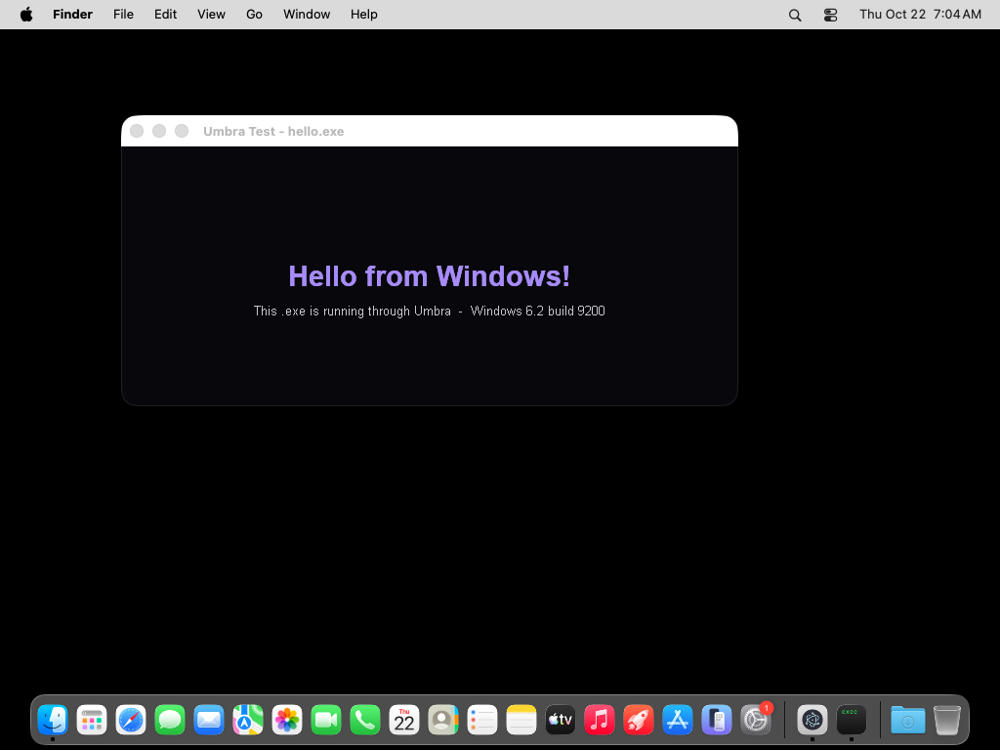 | 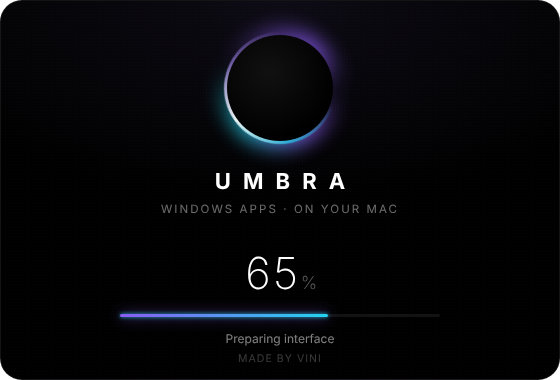 |
| 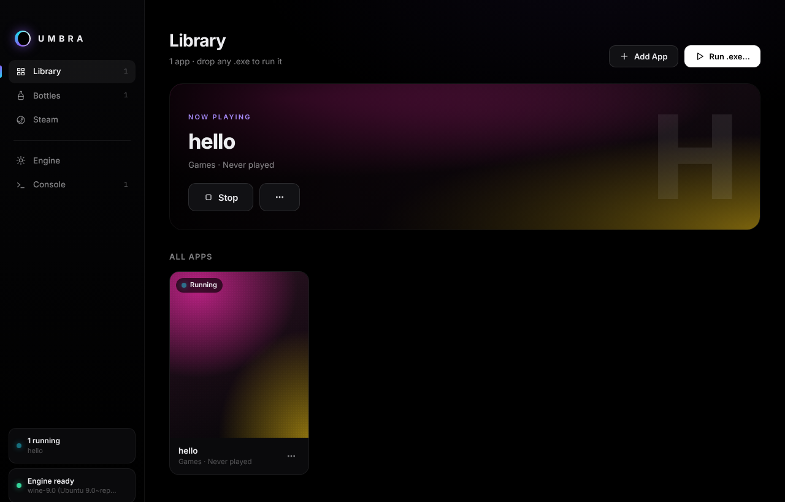 | 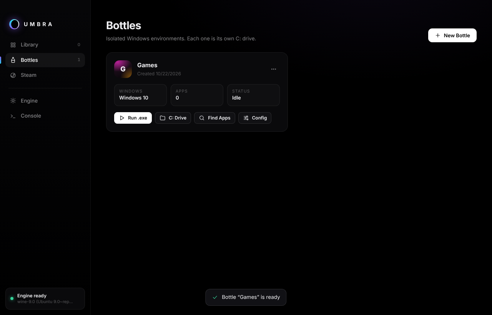 |
| 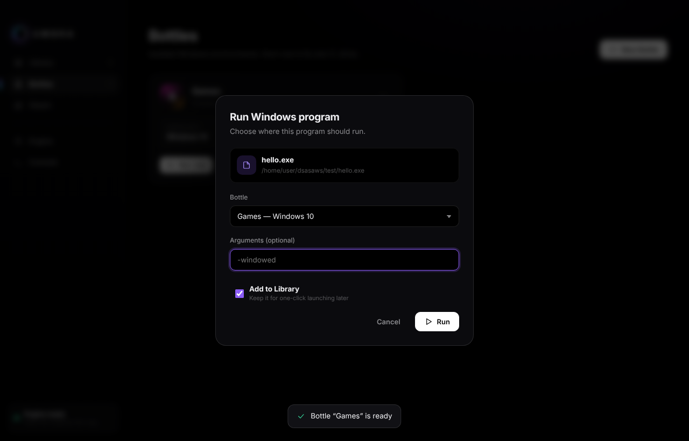 | 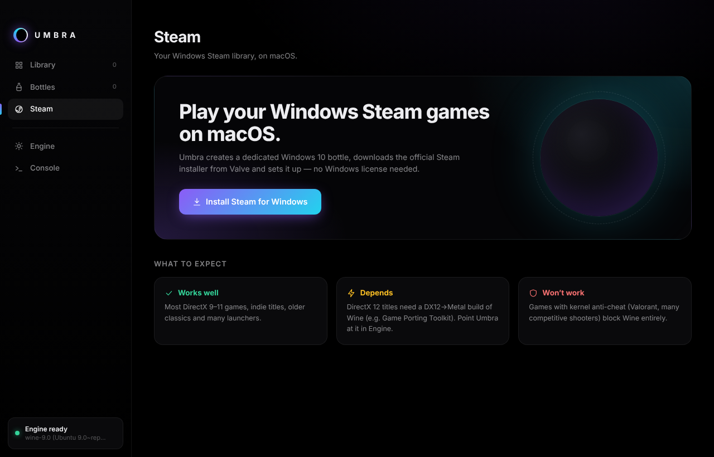 |
| 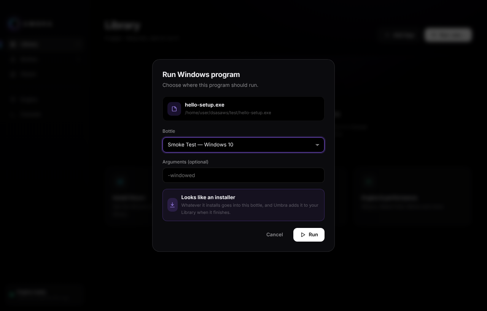 | 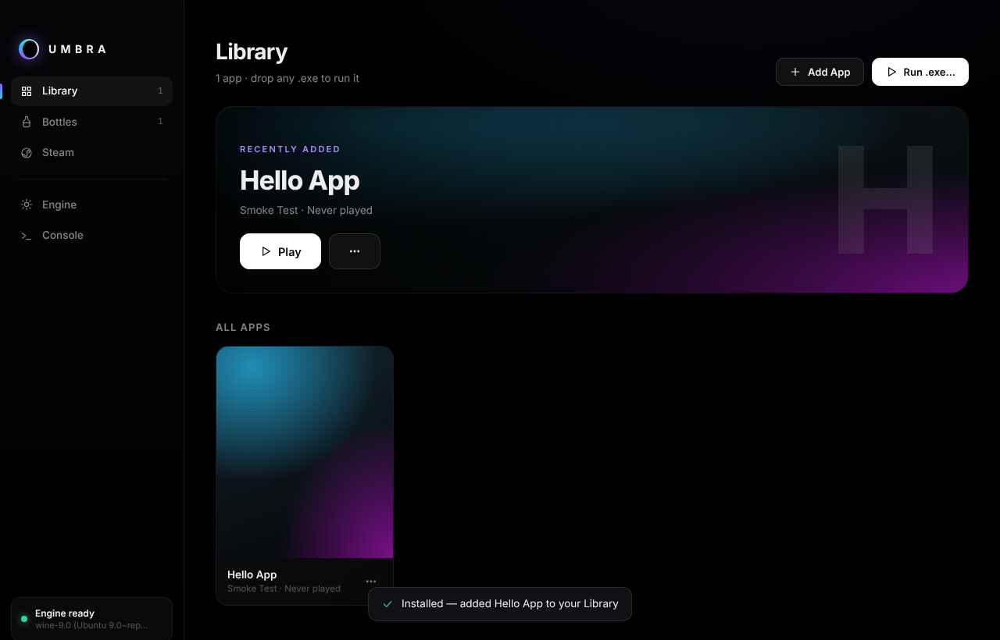 |
| 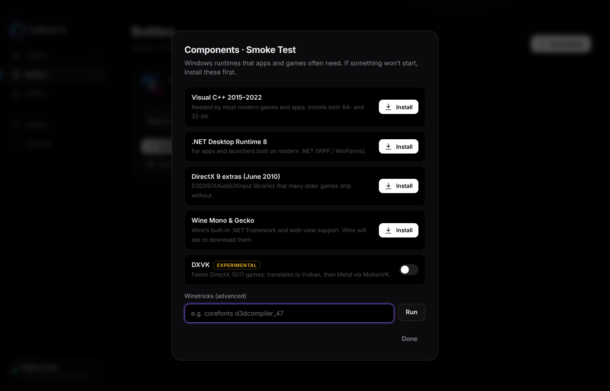 | 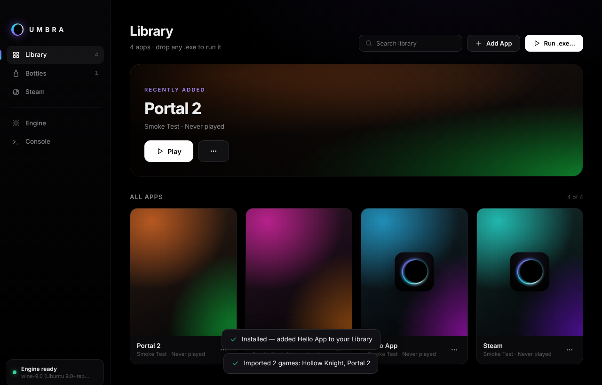 |
| 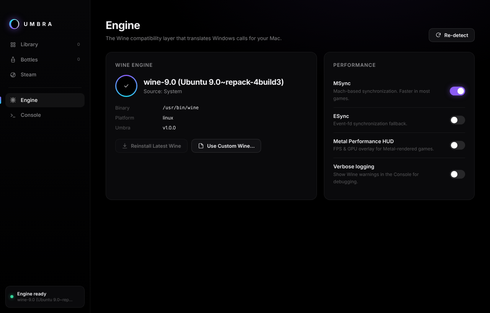 | 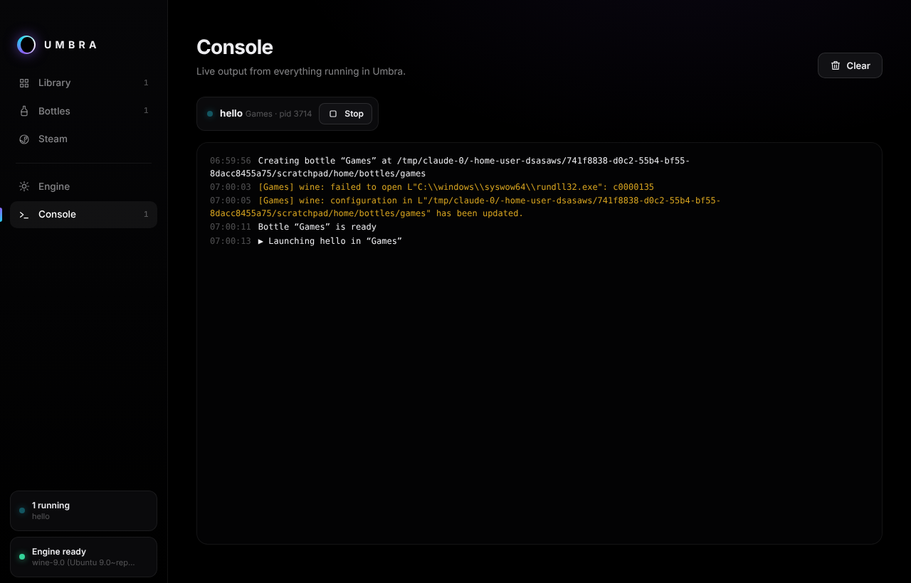 |

## Install

1. Download the latest `.dmg` from **[Releases](../../releases)**: `arm64` for Apple Silicon, `x64` for Intel Macs.
2. Drag **Umbra** into **Applications**.
3. Umbra isn't notarized, so macOS blocks it the first time. Open it once, then go to **System Settings → Privacy & Security → Open Anyway**. You can also run `xattr -cr /Applications/Umbra.app` in Terminal instead.
4. In Umbra, open **Engine** and click **Install Engine**. On Apple Silicon, also click **Install Rosetta**.

## Compatibility

Wine runs a lot of software, but not all of it:

| | |
|---|---|
| ✅ Works well | Most DirectX 9–11 games, indie games, older titles, many launchers and utilities |
| ⚠️ Depends | DirectX 12 games need a Wine build with D3D12→Metal (e.g. Apple's Game Porting Toolkit). Choose it with **Engine → Use Custom Wine…** |
| ❌ Won't work | Games with kernel anti-cheat (Valorant, many competitive shooters) |

## Develop

```bash
npm install
npm start               # run the app
npm run dist:mac        # build Umbra .dmg + .zip (on a Mac)
npx electron test/smoke.js   # end-to-end: engine → bottle → installer → run installed app
```

Each push to `main` runs a GitHub Actions job on a real Mac. That job installs the Wine engine, creates a bottle, runs a test installer (`test/hello-setup.exe`), checks the installed app was added to the Library and runs it, then builds the app and publishes the `.dmg` and `.zip` files as release `v<version>`, using the version in `package.json`.

## How it works

| File | Role |
|---|---|
| `src/main.js` | Electron main process: loading screen, windows, IPC |
| `src/engine.js` | Finds or installs Wine, checks Rosetta |
| `src/runtime.js` | Bottles (Wine prefixes), launching programs, installer tracking, Steam setup, DXVK |
| `src/components.js` | Visual C++ / .NET / DirectX installers and winetricks |
| `src/steamlib.js` | Reads Steam app manifests to import games |
| `src/icons.js` | Extracts icons from Windows executables |
| `src/renderer/` | The UI (`index.html`, `app.js`, `styles.css`) and loading screen (`splash.html`) |

Umbra data lives in `~/Library/Application Support/Umbra` (bottles, engine, library).
